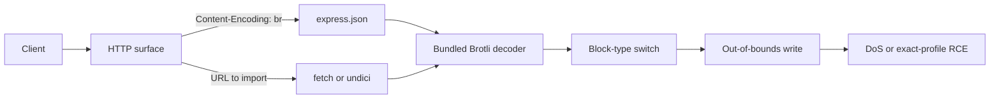
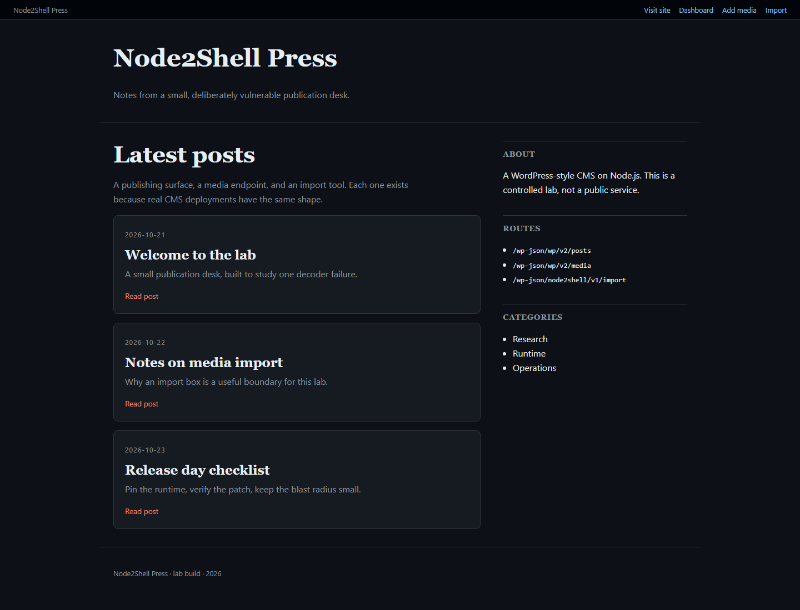
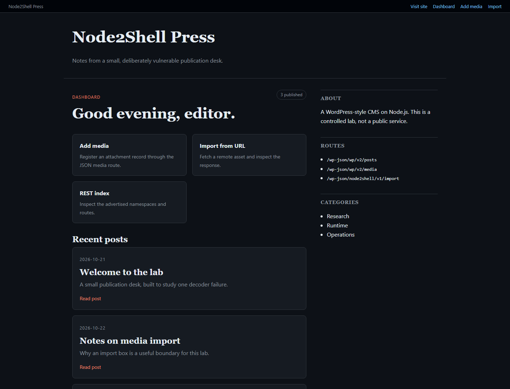

```text
 _  _  ___  ___ ___   ___ _  _ ___ _    _    _   ___
| \| |/ _ \|   \ __| / __| || | __| |  | |  /_\ | _ )
| .` | (_) | |) / _| \__ \ __ | _|| |__| |_/ _ \| _ \
|_|\_|\___/|___/___| |___/_||_|___|____|____/ \_\___/
```

# Node2Shell Lab

**A reproducible, loopback-only lab for CVE-2026-111497, the Brotli decoder
out-of-bounds write bundled with affected Node.js releases.** The repository
contains three small applications, a stdlib-only Python proof of concept, and
raw run logs. Two exact-binary profiles returned fresh `id` output in 2/2
fresh containers; the third profile reproduced denial of service in 2/2.
The RCE result is profile-specific and probabilistic. It is not a claim about
every Node.js deployment.

[](https://nodejs.org/en/blog/vulnerability/october-2026-security-releases)
[](https://docs.docker.com/)
[](LICENSE)
[](docs/evidence/MATRIX.md)
[](https://www.cisa.gov/known-exploited-vulnerabilities-catalog)

## Labs at a glance

| Lab | Runtime | Inbound / outbound sink | DoS evidence | RCE evidence |
| --- | --- | --- | --- | --- |
| [WordPress-style CMS](lab/wp-cms/) | Node.js v24.22.0 | `POST /wp-json/wp/v2/media` and import-by-URL | [2/2 PASS](docs/evidence/wp-cms-dos-run1.txt) | [2/2 PASS](docs/evidence/wp-cms-rce-run1.txt) |
| [Link Unfurl API](lab/unfurl-api/) | Node.js v24.22.0 + undici 8.12.3 | `POST /api/unfurl` fetches and consumes a body | [2/2 PASS](docs/evidence/unfurl-api-dos-run1.txt) | Not claimed |
| [Reference Express](lab/reference-express/) | Node.js v24.22.0 | `POST /upload` with default `express.json()` | [2/2 PASS](docs/evidence/ref-express-dos-run1.txt) | [2/2 PASS](docs/evidence/ref-express-rce-run1.txt) |

All three patched controls failed closed with
`ERR__ERROR_FORMAT_BLOCK_SWITCH` while `/health` stayed available:
[reference](docs/evidence/ref-express-patched-control.txt),
[CMS](docs/evidence/wp-cms-patched-control.txt),
[unfurl](docs/evidence/unfurl-api-patched-control.txt).

## How the data reaches the decoder



The inbound path inflates a request body in the HTTP worker. The outbound path
fetches an attacker-controlled response and reads it to completion. Both paths
reach the same decoder before application code can validate the content.

## Quick Start

The three commands below run the deterministic CMS denial-of-service check.
Docker must be running and the host port `3000` must be free.

```bash
make lab-a
make poc-a
make clean
```

Expected result:

```text
PASS: DoS verified through the declared network interface
profile=n2s-wp-24.22.0-x86_64
trigger_sha256=b7a6508eb39ef57ae5e3fdf9aa85540071a06eff5d5b5a2d359fc8e1768e4df4
postcondition=service unavailable
healthchecks_failed=4/4
```

To run the exact-binary RCE path instead:

```bash
make lab-ref
make poc-ref
make clean
```

One observed run ended with the block below. The attempt count varies with the
address-space layout.

```text
PASS: RCE verified by fresh id output through the declared interface
profile=n2s-ref-express-24.22.0-x86_64
proof_channel=HTTP request socket stdout
proof_command=id
proof_stdout=uid=1000(node) gid=1000(node) groups=1000(node)
successful_attempt=8
```

## Contents

- [What is the bug](#what-is-the-bug)
- [Why request inflation matters](#why-request-inflation-matters)
- [Affected and fixed versions](#affected-and-fixed-versions)
- [Verification protocol](#verification-protocol)
- [Mitigations](#mitigations)
- [Repository map](#repository-map)
- [Demos and screenshots](#demos-and-screenshots)
- [Limitations](#limitations)
- [FAQ](#faq)
- [References](#references)

## What is the bug

The vulnerable component is the Brotli decoder in `c/dec/decode.c`, which is
compiled into affected Node.js binaries. Brotli streams are split into meta
blocks, and each meta block carries a block type. The decoder dispatches on
that block type through a switch. A malformed stream can select a block type
whose write is not bounded by the destination buffer, producing an
out-of-bounds write.

The write corrupts decoder state and adjacent heap memory. The first visible
effect is usually a crash of the process that hosts the decoder. Under the
right allocator layout, the corrupted state can influence control flow; this
repository demonstrates that outcome only in the two exact application
profiles recorded in the matrix.

The trigger in `poc.py` is a malformed stream. Its SHA-256 is a hard invariant:

```text
b7a6508eb39ef57ae5e3fdf9aa85540071a06eff5d5b5a2d359fc8e1768e4df4
```

`python poc.py --self-test` rebuilds the stream and fails if the digest or size
changes. The same digest is checked by CI.

## Why request inflation matters

An HTTP parser normally rejects invalid JSON before application code sees it.
When `Content-Encoding: br` is present, the body parser inflates the request
first. The malformed bytes therefore reach the Brotli decoder, and the decoder
runs inside the process that owns the HTTP socket. The same applies to a
server-side fetch that consumes an encoded response: the decoder is reached
during ordinary body handling.

This is why "limit the JSON body size" is not a fix by itself. The compressed
request can be small while the decoder's internal write is malformed. Limits
reduce how much attacker-controlled input is accepted, but the decoder must
still be patched.

## Affected and fixed versions

These are the release-line boundaries reported for this CVE. Only the Node.js
v24.22.0 and v24.22.1 images are re-tested in this repository.

| Release line | Affected | Fixed | Re-tested here |
| --- | --- | --- | --- |
| Node.js 22.x | 22.23.3 and earlier | 22.23.4 | No |
| Node.js 24.x | 24.22.0 and earlier | 24.22.1 | Yes, both sides |
| Node.js 26.x | 26.12.0 and earlier | 26.12.1 | No |
| Node.js 20.x | End-of-life line | Upgrade | No |

The exact tested digests are:

| Role | Digest |
| --- | --- |
| Affected | `node@sha256:925de64a85319052d6971ae81ef2417da956e8a3a2c4a0fac732327970f017f5` |
| Patched control | `node@sha256:6449e19d8184d84062525b6a7524def03146c2cb04a7f08b076680d0e8e4240a` |

## Verification protocol

For each lab, the operator built the pinned image, started a fresh container,
ran `poc.py` over loopback, and stored the complete transcript. Affected RCE
profiles were run in two separate containers. A PASS requires complete
`uid=` and `gid=` output from a fresh `id` invocation. A DoS PASS requires four
consecutive failed `/health` checks after the trigger.

The patched control uses the same application source and package lock with the
v24.22.1 digest. The request must fail with
`ERR__ERROR_FORMAT_BLOCK_SWITCH`, and `/health` must still return `PONG`.
The claim-by-claim table, timestamps, hashes, and non-claims are in
[`docs/evidence/MATRIX.md`](docs/evidence/MATRIX.md). Hashes for every log are
in [`docs/evidence/SHA256SUMS`](docs/evidence/SHA256SUMS).

`poc.py` is stdlib-only Python 3.11+. It accepts only `127.0.0.1`, `::1`, or
`localhost` and the port declared by the selected profile. It never accepts a
caller-supplied command.

## Mitigations

1. **Upgrade the runtime.** Use Node.js v24.22.1 or later on the 24.x line,
   v22.23.4 or later on 22.x, and v26.12.1 or later on 26.x. Pin the image by
   digest, not by a floating tag.
2. **Upgrade Brotli.** If Brotli is built separately, move to the fixed
   upstream release, 1.2.1 or later, and rebuild against it.
3. **Reduce parser exposure.** Lower the request body limit and reject
   encodings that the application does not need. This is defense in depth, not
   a replacement for the decoder patch.
4. **Isolate workers.** Run the HTTP server under a restart supervisor with
   resource limits. A decoder crash should not take down the whole host.
5. **Restrict outbound fetches.** Allowlist destinations and cap response
   bytes. The unfurl lab accepts only loopback targets for this reason.
6. **Treat RCE as possible.** Do not rely on "it only crashes" when the
   affected process handles untrusted compressed data.

## Repository map

```text
lab/wp-cms/             WordPress-style CMS, JSON media sink, import sink
lab/unfurl-api/         undici link unfurler and HTML tester
lab/reference-express/  minimal Express fixture
poc.py                  stdlib-only loopback reproducer
profiles.json           exact profiles, fingerprints, and evidence pointers
scan.py                 passive three-asset triage
compose.scan.yaml       three labs on ports 19200-19202
docs/architecture.md    trust boundaries and data flow
docs/exploit-walkthrough.md
docs/evidence/          raw logs, checksums, and the claim matrix
docs/demo/              VHS tapes and rendered terminal demos
docs/media/             real headless-Chrome screenshots
```

## Demos and screenshots

Real terminal recordings, rendered with VHS v0.12.1 from the checked-in tapes:

- [Reference Express RCE](docs/demo/ref-express-rce.gif) ·
  [MP4](docs/demo/ref-express-rce.mp4) ·
  [ASCII](docs/demo/ref-express-rce.ascii) ·
  [tape](docs/demo/ref-express-rce.tape)
- [WordPress-style CMS RCE](docs/demo/wp-cms-rce.gif) ·
  [MP4](docs/demo/wp-cms-rce.mp4) ·
  [ASCII](docs/demo/wp-cms-rce.ascii) ·
  [tape](docs/demo/wp-cms-rce.tape)
- [WordPress-style CMS DoS](docs/demo/wp-cms-dos.gif) ·
  [MP4](docs/demo/wp-cms-dos.mp4) ·
  [ASCII](docs/demo/wp-cms-dos.ascii) ·
  [tape](docs/demo/wp-cms-dos.tape)
- [Unfurl API DoS](docs/demo/unfurl-api-dos.gif) ·
  [MP4](docs/demo/unfurl-api-dos.mp4) ·
  [ASCII](docs/demo/unfurl-api-dos.ascii) ·
  [tape](docs/demo/unfurl-api-dos.tape)
- [Passive scan](docs/demo/scan.gif) ·
  [MP4](docs/demo/scan.mp4) ·
  [ASCII](docs/demo/scan.ascii) ·
  [tape](docs/demo/scan.tape)

Real browser screenshots, captured with headless Chrome:






## Limitations

- The RCE result is **exact-profile**. It depends on the pinned Node.js
  v24.22.0 binary, Debian bookworm userspace, Express 5.3.0 with body-parser
  2.4.0, `UV_THREADPOOL_SIZE=1`, and file descriptor 19 for the accepted
  socket. A different deployment can be affected and still not match this
  layout.
- Success is probabilistic because the profile guesses an ASLR-dependent saved
  return address. A failed attempt proves nothing about safety. The supervisor
  is used to obtain a fresh process between attempts.
- The unfurl profile claims denial of service only. No RCE was attempted or
  claimed for it.
- Only the v24.22.0 and v24.22.1 images were re-tested. The 22.x and 26.x
  fixed boundaries are reported, not re-verified here.
- The evidence was produced on Docker Desktop for Windows with Linux
  `amd64` containers. Native Node.js, Windows containers, ARM, and other libc
  layouts are out of scope.
- `scan.py` is passive triage. It does not prove exploitability, and a missing
  version header is not evidence of safety.
- The CISA KEV badge links to the catalog for checking; this repository does
  not assert a listing status independently.

## FAQ

**Is this a zero-day?** No. It is a public CVE with a public vendor advisory and
a fixed release.

**Does this work against every Node.js 24.22.0 service?** No. RCE is proven
only for the composed profiles. Many services will crash or reject the stream.

**Why do some labs return `id` output?** The write can redirect a saved return
address into a small ROP chain that duplicates the accepted socket onto stdout
and executes `/usr/bin/id`. That is a fixed proof command; the tool accepts no
arbitrary command.

**Why is a restart supervisor needed?** A missed ASLR guess crashes the worker.
The supervisor starts a new process with a new memory layout so the next guess
is meaningful.

**Can I point the PoC at my own server?** No. The host is restricted to loopback
forms, the port must match the profile, and the request paths are fixed.

**Does `make verify` prove RCE?** No. It proves the deterministic DoS paths and
the patched controls from a clean state. RCE evidence is separate because it is
probabilistic.

**Where is the full claim table?** [`docs/evidence/MATRIX.md`](docs/evidence/MATRIX.md).

## References

- [Node.js October 2026 security releases](https://nodejs.org/en/blog/vulnerability/october-2026-security-releases)
- [Upstream Brotli decoder fix](https://github.com/google/brotli/commit/0ed4268a4401abcb44720963)
- [Vercel Node.js security bulletin](https://vercel.com/kb/bulletin/node-js-security-advisory)
- [CISA Known Exploited Vulnerabilities catalog](https://www.cisa.gov/known-exploited-vulnerabilities-catalog)
- [Express body-parser documentation](https://expressjs.com/en/resources/middleware/body-parser.html)
- [undici documentation](https://undici.nodejs.org/)

## License

MIT. See [LICENSE](LICENSE). Use only on systems you own or are explicitly
authorized to test. See [AUTHORIZED_USE.md](AUTHORIZED_USE.md) and
[SECURITY.md](SECURITY.md).
