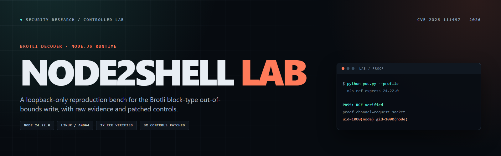
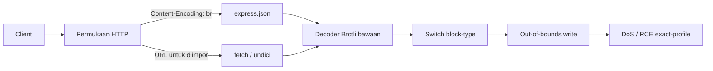
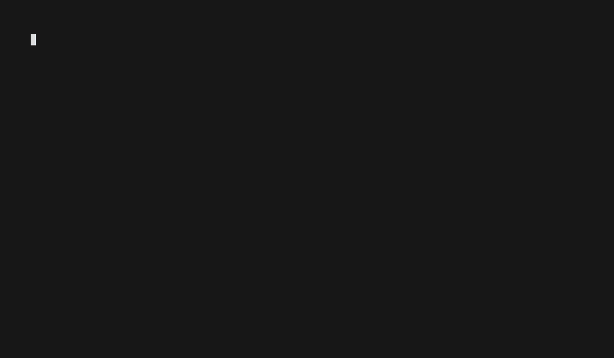
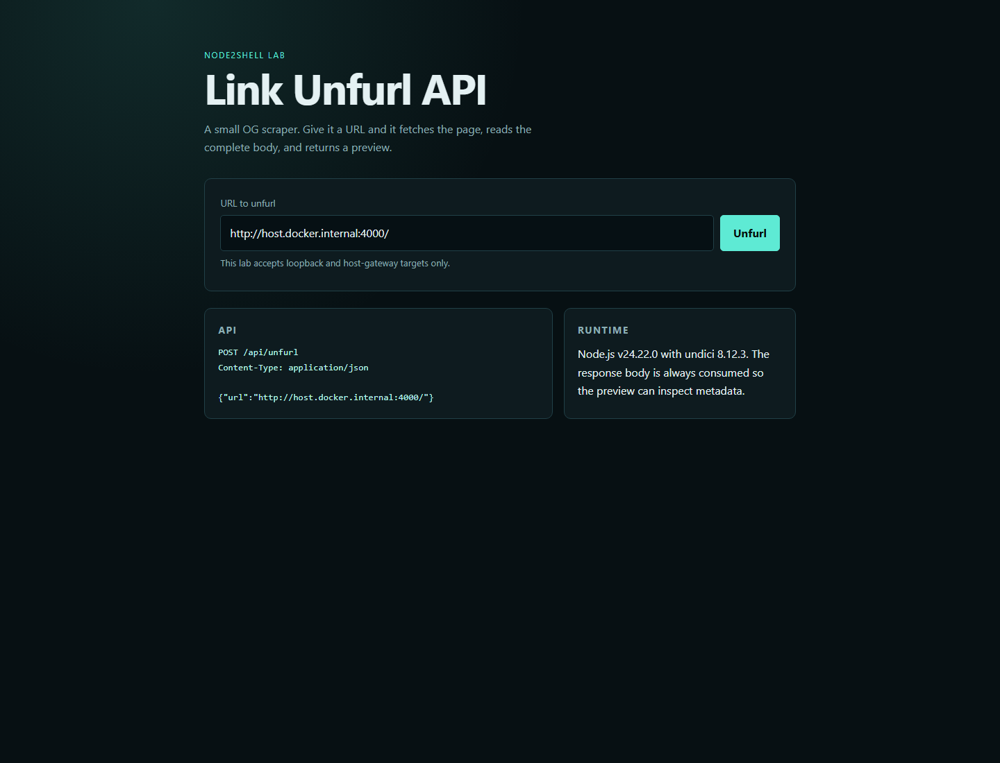

<p align="center">
  
</p>

<p align="center">
  
  
  
  
  
  
  
</p>

<h1 align="center">Node2Shell Lab</h1>

<p align="center">
  Lab reproduksi loopback untuk out-of-bounds write pada decoder Brotli<br>
  yang dibundel dengan rilis Node.js terdampak.
</p>

---

## Gambaran Umum

Node2Shell Lab adalah lingkungan riset keamanan terkontrol untuk
**CVE-2026-111497**. Repo ini memuat tiga aplikasi kecil, proof of concept
Python dengan profil exact, kontrol patched, dan bukti mentah dari container
yang baru dibuat.

Cakupannya sengaja dibuat sempit: satu runtime utama, satu trigger, dan beberapa
bentuk aplikasi yang terdefinisi. Tujuannya bukan menyediakan exploit kit
produksi. Tujuannya adalah membuat setiap klaim dapat direproduksi, diaudit, dan
dibandingkan langsung dengan runtime yang sudah diperbaiki.

> [!IMPORTANT]
> Hasil RCE bersifat exact-profile dan probabilistik. Hasil ini bergantung pada
> binary dan package lock yang dikunci, satu worker libuv, file descriptor 19
> untuk socket yang diterima, serta layout yang bergantung pada ASLR. Ini bukan
> klaim umum untuk semua deployment Node.js.

### Ringkasan verifikasi

| Klaim | Hasil | Bukti |
| --- | --- | --- |
| RCE Reference Express | **2/2 PASS** | [run 1](docs/evidence/ref-express-rce-run1.txt) · [run 2](docs/evidence/ref-express-rce-run2.txt) |
| RCE WordPress-style CMS | **2/2 PASS** | [run 1](docs/evidence/wp-cms-rce-run1.txt) · [run 2](docs/evidence/wp-cms-rce-run2.txt) |
| DoS WordPress-style CMS | **2/2 PASS** | [run 1](docs/evidence/wp-cms-dos-run1.txt) · [run 2](docs/evidence/wp-cms-dos-run2.txt) |
| DoS Unfurl API | **2/2 PASS** | [run 1](docs/evidence/unfurl-api-dos-run1.txt) · [run 2](docs/evidence/unfurl-api-dos-run2.txt) |
| Kontrol patched | **3/3 FAIL CLOSED** | [matriks](docs/evidence/MATRIX.md) |

Batas klaim lengkap, timestamp, dan hash tersedia di
[`docs/evidence/MATRIX.md`](docs/evidence/MATRIX.md).

---

## Daftar Isi

- [Arsitektur](#arsitektur)
- [Lab](#lab)
- [Demo](#demo)
- [Tangkapan Layar](#tangkapan-layar)
- [Mulai Cepat](#mulai-cepat)
- [Hasil Verifikasi](#hasil-verifikasi)
- [Ringkasan Teknis](#ringkasan-teknis)
- [Versi Terdampak dan Diperbaiki](#versi-terdampak-dan-diperbaiki)
- [Mitigasi](#mitigasi)
- [Struktur Repositori](#struktur-repositori)
- [Perkakas](#perkakas)
- [Cakupan dan Batasan](#cakupan-dan-batasan)
- [Penggunaan yang Bertanggung Jawab](#penggunaan-yang-bertanggung-jawab)
- [Referensi](#referensi)

---

## Arsitektur



Jalur masuk menginflasi body request sebelum JSON divalidasi. Jalur keluar
mengambil response yang dikendalikan penyerang lalu mengonsumsinya sampai
habis. Kedua jalur mencapai decoder di dalam proses Node.js sebelum kode
aplikasi sempat memeriksa isinya.

---

## Lab

| Lab | Bentuk aplikasi | Runtime | Hasil utama |
| --- | --- | --- | --- |
| [`labs/wp-cms`](labs/wp-cms/) | CMS bergaya WordPress, route media JSON, impor lewat URL | Node.js v24.22.0 | RCE 2/2; DoS 2/2 |
| [`labs/unfurl-api`](labs/unfurl-api/) | Link unfurler dengan undici 8.12.3 | Node.js v24.22.0 | DoS 2/2; RCE tidak diklaim |
| [`labs/reference-express`](labs/reference-express/) | Fixture Express minimal untuk mempertahankan profil RCE exact | Node.js v24.22.0 | RCE 2/2; DoS 2/2 |

Setiap lab memiliki `Dockerfile`, `Dockerfile.patched`, endpoint health
loopback, supervisor restart, dan README khusus lab. Semua image berjalan
sebagai `USER node`.

### Sink

| Lab | Sink | Path |
| --- | --- | --- |
| WordPress-style CMS | Body JSON yang didekode Brotli | `POST /wp-json/wp/v2/media` |
| WordPress-style CMS | Body response hasil fetch | `POST /wp-json/node2shell/v1/import` |
| Unfurl API | Body response hasil fetch | `POST /api/unfurl` |
| Reference Express | Body JSON yang didekode Brotli | `POST /upload` |

---

## Demo

<p align="center">
  
</p>

Rekaman animasi di atas adalah hasil VHS dari lab reference, bukan mockup.
Rekaman memperlihatkan `poc.py` publik berjalan terhadap container loopback,
termasuk loop retry setelah tebakan ASLR meleset. Run hanya berakhir ketika
target mengembalikan output `id` baru yang memuat `uid=` dan `gid=`.

<p align="center">
  <a href="docs/assets/demos/ref-express-rce.mp4">MP4</a> ·
  <a href="docs/assets/demos/ref-express-rce.ascii">Transkrip terminal</a> ·
  <a href="docs/assets/demos/ref-express-rce.tape">VHS tape</a> ·
  <a href="docs/evidence/ref-express-rce-run1.txt">Bukti mentah</a>
</p>

### Rekaman tambahan

| Rekaman | Isi | Format |
| --- | --- | --- |
| RCE WordPress CMS | Sink media JSON mengembalikan output `id` baru | [GIF](docs/assets/demos/wp-cms-rce.gif) · [MP4](docs/assets/demos/wp-cms-rce.mp4) · [ASCII](docs/assets/demos/wp-cms-rce.ascii) |
| DoS WordPress CMS | Sink impor menjadi tidak tersedia; 4/4 health check gagal | [GIF](docs/assets/demos/wp-cms-dos.gif) · [MP4](docs/assets/demos/wp-cms-dos.mp4) · [ASCII](docs/assets/demos/wp-cms-dos.ascii) |
| DoS Unfurl API | Jalur fetch menjadi tidak tersedia; 4/4 health check gagal | [GIF](docs/assets/demos/unfurl-api-dos.gif) · [MP4](docs/assets/demos/unfurl-api-dos.mp4) · [ASCII](docs/assets/demos/unfurl-api-dos.ascii) |
| Pemindaian pasif | Triage terbatas terhadap tiga lab Compose | [GIF](docs/assets/demos/passive-scan.gif) · [MP4](docs/assets/demos/passive-scan.mp4) · [ASCII](docs/assets/demos/passive-scan.ascii) |

---

## Tangkapan Layar

<p align="center">
  
  
</p>

<p align="center">
  <sub>Diambil dengan headless Chrome dari container lab yang berjalan. Dashboard CMS tersedia di <a href="docs/assets/screenshots/wp-cms-admin.png">tangkapan layar ini</a>.</sub>
</p>

---

## Mulai Cepat

### Kebutuhan

- Docker Desktop atau Docker Engine dengan dukungan Linux `amd64`
- Python 3.11+
- GNU Make, atau perintah setara dari README tiap lab
- Port `3000` tersedia di loopback

### Uji DoS deterministik

```bash
make lab-a
make poc-a
make clean
```

Hasil yang diharapkan:

```text
PASS: DoS verified through the declared network interface
postcondition=service unavailable
healthchecks_failed=4/4
```

### Uji RCE exact-profile

```bash
make lab-ref
make poc-ref
make clean
```

Salah satu run yang diamati berakhir dengan:

```text
PASS: RCE verified by fresh id output through the declared interface
proof_channel=HTTP request socket stdout
proof_command=id
proof_stdout=uid=1000(node) gid=1000(node) groups=1000(node)
successful_attempt=8
```

Jumlah attempt dapat berubah tergantung layout address space.

### Pemeriksaan deterministik lengkap

```bash
make verify
```

`make verify` membersihkan workspace, membangun ulang semua image affected dan
patched, menjalankan self-test, memverifikasi dua lab DoS, lalu memeriksa ketiga
kontrol patched. RCE tetap dijalankan terpisah karena bersifat probabilistik.

---

## Hasil Verifikasi

Protokol verifikasinya sengaja dibuat sederhana:

1. Bangun image exact dari Dockerfile dan package lock yang ada di repo.
2. Jalankan container baru.
3. Jalankan `poc.py` melalui interface loopback yang dideklarasikan.
4. Terima PASS hanya jika ada output `uid=` dan `gid=` baru, atau empat health
   check yang gagal berturut-turut.
5. Ulangi di container baru kedua.
6. Kirim request yang sama ke kontrol v24.22.1 dan wajibkan
   `ERR__ERROR_FORMAT_BLOCK_SWITCH` dengan `/health` tetap tersedia.

| Profil | Klaim | Attempt | Status |
| --- | --- | ---: | --- |
| `n2s-ref-express-24.22.0-x86_64` | RCE | 8, 7 | PASS 2/2 |
| `n2s-wp-24.22.0-x86_64` | RCE | 1, 1 | PASS 2/2 |
| `n2s-ref-express-24.22.0-x86_64` | DoS | 1, 1 | PASS 2/2 |
| `n2s-wp-24.22.0-x86_64` | DoS | 1, 1 | PASS 2/2 |
| `n2s-unfurl-24.22.0-x86_64` | DoS | 1, 1 | PASS 2/2 |

Checksum setiap transkrip ada di
[`docs/evidence/SHA256SUMS`](docs/evidence/SHA256SUMS). Bukti negatif sama
pentingnya: tidak ada RCE yang diklaim untuk profil unfurl, dan lini rilis 22.x
serta 26.x tidak diuji ulang di sini.

---

## Ringkasan Teknis

Komponen rentan adalah decoder Brotli di `c/dec/decode.c`, yang dikompilasi ke
dalam binary Node.js terdampak. Stream cacat memaksa cabang switch block-type
menulis melewati batas buffer tujuan, merusak state decoder dan heap di
sekitarnya. Efek pertama yang terlihat biasanya adalah crash proses. Pada layout
exact yang tercatat di `profiles.json`, korupsi tersebut dapat memengaruhi alur
kontrol dan mengembalikan output `id` baru pada socket yang dieksploitasi.

Digest trigger adalah invariant keras:

```text
b7a6508eb39ef57ae5e3fdf9aa85540071a06eff5d5b5a2d359fc8e1768e4df4
```

`python poc.py --self-test` membangun ulang stream dan gagal jika digest atau
ukurannya berubah. CI menjalankan pemeriksaan yang sama.

### Mengapa body terkompresi penting

`Content-Encoding: br` memindahkan decoder ke depan validasi JSON. Fetch di sisi
server yang membaca response terkompresi mencapai decoder yang sama melalui
konsumsi body normal. Batas ukuran body JSON mengurangi paparan, tetapi tidak
memperbaiki decoder. Patch runtime adalah perbaikan yang sebenarnya.

---

## Versi Terdampak dan Diperbaiki

Hanya image Node.js v24.22.0 dan v24.22.1 yang diuji ulang di repo ini.

| Lini rilis | Dilaporkan terdampak | Diperbaiki | Diuji ulang |
| --- | --- | --- | --- |
| Node.js 22.x | 22.23.3 dan sebelumnya | 22.23.4 | Tidak |
| Node.js 24.x | 24.22.0 dan sebelumnya | 24.22.1 | Ya, kedua sisi |
| Node.js 26.x | 26.12.0 dan sebelumnya | 26.12.1 | Tidak |
| Node.js 20.x | End-of-life | Upgrade | Tidak |

| Peran | Digest image |
| --- | --- |
| Affected | `node@sha256:925de64a85319052d6971ae81ef2417da956e8a3a2c4a0fac732327970f017f5` |
| Kontrol patched | `node@sha256:6449e19d8184d84062525b6a7524def03146c2cb04a7f08b076680d0e8e4240a` |

---

## Mitigasi

1. Upgrade ke Node.js v24.22.1, v22.23.4, atau v26.12.1 sesuai lini rilis, dan
   kunci image berdasarkan digest.
2. Jika Brotli dibangun terpisah, gunakan rilis upstream yang sudah diperbaiki,
   yaitu 1.2.1 atau lebih baru.
3. Turunkan batas ukuran body request dan tolak encoding yang tidak dibutuhkan
   aplikasi. Anggap ini sebagai pertahanan berlapis, bukan perbaikan decoder.
4. Jalankan worker HTTP dengan resource limit dan supervisor restart agar satu
   crash decoder tidak menjatuhkan seluruh host.
5. Batasi tujuan fetch keluar dan batasi ukuran response.
6. Jangan berasumsi "hanya crash" saat proses menangani data terkompresi dari
   pihak yang tidak dipercaya.

---

## Struktur Repositori

```text
.
├── deploy/
│   ├── compose.scan.yaml         # Tiga lab pada port loopback 19200-19202
│   └── targets.txt               # Daftar aset untuk scanner pasif
├── docs/
│   ├── assets/
│   │   ├── banner.png
│   │   ├── demos/                # VHS tape, GIF/MP4, transkrip ASCII
│   │   └── screenshots/          # Tangkapan asli headless Chrome
│   ├── architecture.md
│   ├── exploit-walkthrough.md
│   ├── troubleshooting.md
│   ├── faq.md
│   ├── authorized-use.md
│   ├── evidence/                 # Log mentah, checksum, matriks klaim
│   ├── labs/                     # Catatan khusus aplikasi
│   └── index.html                # Landing page GitHub Pages tanpa dependensi
├── labs/
│   ├── wp-cms/
│   ├── unfurl-api/
│   └── reference-express/
├── tools/
│   └── scan.py                   # Triage pasif tiga aset
├── .github/
│   ├── SECURITY.md
│   ├── CONTRIBUTING.md
│   └── workflows/verify.yml
├── poc.py
├── profiles.json
├── Makefile
├── CHANGELOG.md
├── CITATION.cff
└── LICENSE
```

File ZIP hasil generate, cache lokal, `node_modules`, bytecode Python, dan varian
lab lama sengaja tidak disertakan.

---

## Perkakas

| Perintah | Fungsi |
| --- | --- |
| `make self-test` | Bangun ulang trigger dan verifikasi digest-nya |
| `make lab-a` | Jalankan lab CMS di loopback |
| `make poc-a` | Jalankan uji DoS CMS |
| `make poc-a-rce` | Jalankan percobaan RCE exact-profile CMS |
| `make lab-b` | Jalankan unfurl API |
| `make poc-b` | Jalankan uji DoS unfurl |
| `make lab-ref` | Jalankan lab Reference Express dengan supervisor |
| `make poc-ref` | Jalankan percobaan RCE reference |
| `make patched` | Bangun semua image kontrol patched |
| `make verify` | Bersihkan, bangun, jalankan self-test, uji DoS, dan kontrol |
| `make demo` | Render ulang rekaman VHS pemindaian pasif |
| `make clean` | Hapus container, image lab, dan cache Python |

[`tools/scan.py`](tools/scan.py) hanya melakukan triage HEAD/GET terbatas. Alat
ini tidak pernah mengirim stream cacat dan tidak pernah memanggil PoC.

---

## Cakupan dan Batasan

- Hasil RCE bersifat exact-profile: Node.js v24.22.0 yang dikunci, Debian
  bookworm, Express 5.3.0/body-parser 2.4.0, `UV_THREADPOOL_SIZE=1`, file
  descriptor 19 untuk socket yang diterima, dan supervisor restart.
- Penempatan ASLR bersifat probabilistik. Percobaan yang gagal tidak
  membuktikan bahwa target aman.
- Profil unfurl hanya mengklaim denial of service. Tidak ada RCE yang dicoba
  atau diklaim untuk profil tersebut.
- Hanya image v24.22.0 dan v24.22.1 yang diuji ulang. Batas perbaikan 22.x dan
  26.x yang dilaporkan belum diverifikasi di mesin ini.
- Bukti dibuat di Docker Desktop untuk Windows dengan container Linux `amd64`.
  Node.js native, ARM, container Windows, dan layout libc lain di luar cakupan.
- Badge CISA KEV hanya menautkan ke katalog untuk pengecekan status; repo ini
  tidak mengklaim sendiri bahwa CVE tercantum di sana.
- `tools/scan.py` adalah triage pasif, bukan mesin keputusan exploitability.

---

## Penggunaan yang Bertanggung Jawab

Gunakan repo ini hanya terhadap lab loopback yang disertakan di mesin yang Anda
kendalikan, atau terhadap sistem yang Anda punya izin tertulis eksplisit untuk
diuji. PoC hanya menerima `127.0.0.1`, `::1`, dan `localhost`, mewajibkan port
dari profil yang dipilih, dan hanya menjalankan `/usr/bin/id` untuk proof RCE.

Baca [panduan penggunaan](docs/authorized-use.md) dan
[kebijakan keamanan](.github/SECURITY.md) sebelum menjalankan lab di host
bersama.

---

## Referensi

- [Rilis keamanan Node.js Oktober 2026](https://nodejs.org/en/blog/vulnerability/october-2026-security-releases)
- [Perbaikan decoder Brotli upstream](https://github.com/google/brotli/commit/0ed4268a4401abcb44720963)
- [Buletin keamanan Node.js dari Vercel](https://vercel.com/kb/bulletin/node-js-security-advisory)
- [Katalog CISA Known Exploited Vulnerabilities](https://www.cisa.gov/known-exploited-vulnerabilities-catalog)
- [Dokumentasi Express body-parser](https://expressjs.com/en/resources/middleware/body-parser.html)
- [Dokumentasi undici](https://undici.nodejs.org/)
- [Arsitektur](docs/architecture.md) · [Panduan exploit](docs/exploit-walkthrough.md) · [FAQ](docs/faq.md)

---

## Lisensi

MIT © 2026 Delvin Alvazri. Lihat [LICENSE](LICENSE) dan
[CITATION.cff](CITATION.cff).

<p align="center">
  <sub>Dikelola oleh Delvin-45 · Dibuat untuk riset loopback, bukan untuk sistem pihak ketiga.</sub>
</p>
