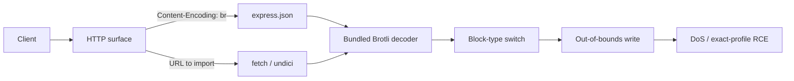

<p align="center">
  
</p>

<p align="center">
  
  
  
  
  
  
  
</p>

<h1 align="center">Node2Shell Lab</h1>

<p align="center">
  A loopback-only reproduction bench for the Brotli decoder out-of-bounds write<br>
  bundled with affected Node.js releases.
</p>

---

## Overview

Node2Shell Lab is a controlled security research environment for
**CVE-2026-111497**. It packages three small applications, an exact-profile
Python proof of concept, patched controls, and raw evidence from fresh
containers.

The repository is deliberately narrow: one runtime, one trigger, and a small
number of well-defined application shapes. The goal is not to provide a
production exploit kit. The goal is to make every claim reproducible, auditable,
and easy to compare against the fixed runtime.

> [!IMPORTANT]
> The RCE results are exact-profile and probabilistic. They depend on the pinned
> binary, package lock, one libuv worker, accepted socket descriptor 19, and an
> ASLR-dependent layout. They are not general claims about every Node.js
> deployment.

### Verification snapshot

| Claim | Result | Evidence |
| --- | --- | --- |
| Reference Express RCE | **2/2 PASS** | [run 1](docs/evidence/ref-express-rce-run1.txt) · [run 2](docs/evidence/ref-express-rce-run2.txt) |
| WordPress-style CMS RCE | **2/2 PASS** | [run 1](docs/evidence/wp-cms-rce-run1.txt) · [run 2](docs/evidence/wp-cms-rce-run2.txt) |
| WordPress-style CMS DoS | **2/2 PASS** | [run 1](docs/evidence/wp-cms-dos-run1.txt) · [run 2](docs/evidence/wp-cms-dos-run2.txt) |
| Unfurl API DoS | **2/2 PASS** | [run 1](docs/evidence/unfurl-api-dos-run1.txt) · [run 2](docs/evidence/unfurl-api-dos-run2.txt) |
| Patched controls | **3/3 FAIL CLOSED** | [matrix](docs/evidence/MATRIX.md) |

The full claim boundary, timestamps, and hashes are in
[`docs/evidence/MATRIX.md`](docs/evidence/MATRIX.md).

---

## Contents

- [Architecture](#architecture)
- [Labs](#labs)
- [Demo](#demo)
- [Screenshots](#screenshots)
- [Quick Start](#quick-start)
- [Verified Results](#verified-results)
- [Technical Summary](#technical-summary)
- [Affected and Fixed Versions](#affected-and-fixed-versions)
- [Mitigations](#mitigations)
- [Repository Layout](#repository-layout)
- [Tooling](#tooling)
- [Scope and Limitations](#scope-and-limitations)
- [Responsible Use](#responsible-use)
- [References](#references)

---

## Architecture



The inbound path inflates a request body before JSON validation. The outbound
path fetches an attacker-controlled response and consumes it completely. Both
paths reach the decoder inside the Node.js process before application code can
inspect the content.

---

## Labs

| Lab | Application shape | Runtime | Primary result |
| --- | --- | --- | --- |
| [`labs/wp-cms`](labs/wp-cms/) | WordPress-style CMS, JSON media route, import-by-URL | Node.js v24.22.0 | RCE 2/2; DoS 2/2 |
| [`labs/unfurl-api`](labs/unfurl-api/) | Link unfurler using undici 8.12.3 | Node.js v24.22.0 | DoS 2/2; RCE not claimed |
| [`labs/reference-express`](labs/reference-express/) | Minimal Express fixture preserving the exact RCE profile | Node.js v24.22.0 | RCE 2/2; DoS 2/2 |

Each lab has a `Dockerfile`, a `Dockerfile.patched`, a loopback health endpoint,
a restart supervisor, and a lab-specific README. All images run as `USER node`.

### Sinks

| Lab | Sink | Path |
| --- | --- | --- |
| WordPress-style CMS | Brotli-decoded JSON request body | `POST /wp-json/wp/v2/media` |
| WordPress-style CMS | Fetched response body | `POST /wp-json/node2shell/v1/import` |
| Unfurl API | Fetched response body | `POST /api/unfurl` |
| Reference Express | Brotli-decoded JSON request body | `POST /upload` |

---

## Demo

<p align="center">
  
</p>

The animated capture above is a VHS recording of the reference lab, not a
mockup. It shows the public `poc.py` running against a loopback container,
including the retry loop used after a missed ASLR guess. The run ends only when
the target returns fresh `id` output containing both `uid=` and `gid=`.

<p align="center">
  <a href="docs/assets/demos/ref-express-rce.mp4">MP4</a> ·
  <a href="docs/assets/demos/ref-express-rce.ascii">Terminal transcript</a> ·
  <a href="docs/assets/demos/ref-express-rce.tape">VHS tape</a> ·
  <a href="docs/evidence/ref-express-rce-run1.txt">Raw evidence</a>
</p>

### Additional recordings

| Recording | What it shows | Formats |
| --- | --- | --- |
| WordPress CMS RCE | JSON media sink returns fresh `id` output | [GIF](docs/assets/demos/wp-cms-rce.gif) · [MP4](docs/assets/demos/wp-cms-rce.mp4) · [ASCII](docs/assets/demos/wp-cms-rce.ascii) |
| WordPress CMS DoS | Import sink becomes unavailable; 4/4 health checks fail | [GIF](docs/assets/demos/wp-cms-dos.gif) · [MP4](docs/assets/demos/wp-cms-dos.mp4) · [ASCII](docs/assets/demos/wp-cms-dos.ascii) |
| Unfurl API DoS | Fetch path becomes unavailable; 4/4 health checks fail | [GIF](docs/assets/demos/unfurl-api-dos.gif) · [MP4](docs/assets/demos/unfurl-api-dos.mp4) · [ASCII](docs/assets/demos/unfurl-api-dos.ascii) |
| Passive scan | Bounded triage of the three Compose labs | [GIF](docs/assets/demos/passive-scan.gif) · [MP4](docs/assets/demos/passive-scan.mp4) · [ASCII](docs/assets/demos/passive-scan.ascii) |

---

## Screenshots

<p align="center">
  
  
</p>

<p align="center">
  <sub>Captured with headless Chrome from the running lab containers. The CMS dashboard is available in <a href="docs/assets/screenshots/wp-cms-admin.png">this screenshot</a>.</sub>
</p>

---

## Quick Start

### Requirements

- Docker Desktop or Docker Engine with Linux `amd64` support
- Python 3.11+
- GNU Make, or the equivalent commands from the lab READMEs
- Port `3000` free on loopback

### Deterministic DoS check

```bash
make lab-a
make poc-a
make clean
```

Expected result:

```text
PASS: DoS verified through the declared network interface
postcondition=service unavailable
healthchecks_failed=4/4
```

### Exact-profile RCE check

```bash
make lab-ref
make poc-ref
make clean
```

One observed run ended with:

```text
PASS: RCE verified by fresh id output through the declared interface
proof_channel=HTTP request socket stdout
proof_command=id
proof_stdout=uid=1000(node) gid=1000(node) groups=1000(node)
successful_attempt=8
```

The attempt count varies with the address-space layout.

### Full deterministic gate

```bash
make verify
```

`make verify` cleans the workspace, rebuilds all affected and patched images,
runs the self-test, verifies the two DoS labs, and checks all three patched
controls. RCE remains a separate two-container evidence run because it is
probabilistic.

---

## Verified Results

The verification protocol is intentionally simple:

1. Build the exact image from the checked-in Dockerfile and package lock.
2. Start a fresh container.
3. Run `poc.py` through the declared loopback interface.
4. Accept a PASS only with fresh `uid=` and `gid=` output, or four consecutive
   failed health checks.
5. Repeat in a second fresh container.
6. Run the same request against the v24.22.1 control and require
   `ERR__ERROR_FORMAT_BLOCK_SWITCH` with `/health` still available.

| Profile | Claim | Attempts | Status |
| --- | --- | ---: | --- |
| `n2s-ref-express-24.22.0-x86_64` | RCE | 8, 7 | PASS 2/2 |
| `n2s-wp-24.22.0-x86_64` | RCE | 1, 1 | PASS 2/2 |
| `n2s-ref-express-24.22.0-x86_64` | DoS | 1, 1 | PASS 2/2 |
| `n2s-wp-24.22.0-x86_64` | DoS | 1, 1 | PASS 2/2 |
| `n2s-unfurl-24.22.0-x86_64` | DoS | 1, 1 | PASS 2/2 |

Checksums for every transcript are in
[`docs/evidence/SHA256SUMS`](docs/evidence/SHA256SUMS). The negative evidence is
equally important: no RCE is claimed for the unfurl profile, and the 22.x/26.x
release lines were not re-tested here.

---

## Technical Summary

The vulnerable component is the Brotli decoder in `c/dec/decode.c`, compiled
into affected Node.js binaries. A malformed stream drives a block-type switch
branch past the bounds of its destination buffer, corrupting decoder state and
adjacent heap memory. The first visible effect is usually a process crash. Under
the exact layout captured in `profiles.json`, the corruption can influence
control flow and return fresh `id` output on the exploited socket.

The trigger digest is a hard invariant:

```text
b7a6508eb39ef57ae5e3fdf9aa85540071a06eff5d5b5a2d359fc8e1768e4df4
```

`python poc.py --self-test` rebuilds the stream and fails if the digest or size
changes. CI runs the same check.

### Why compressed bodies matter

`Content-Encoding: br` moves the decoder ahead of JSON validation. A server-side
fetch that reads a compressed response reaches the same decoder through normal
body consumption. A JSON body limit reduces exposure but does not repair the
decoder. The runtime patch is the actual fix.

---

## Affected and Fixed Versions

Only the Node.js v24.22.0 and v24.22.1 images are re-tested in this repository.

| Release line | Reported affected | Fixed | Re-tested |
| --- | --- | --- | --- |
| Node.js 22.x | 22.23.3 and earlier | 22.23.4 | No |
| Node.js 24.x | 24.22.0 and earlier | 24.22.1 | Yes, both sides |
| Node.js 26.x | 26.12.0 and earlier | 26.12.1 | No |
| Node.js 20.x | End-of-life | Upgrade | No |

| Role | Image digest |
| --- | --- |
| Affected | `node@sha256:925de64a85319052d6971ae81ef2417da956e8a3a2c4a0fac732327970f017f5` |
| Patched control | `node@sha256:6449e19d8184d84062525b6a7524def03146c2cb04a7f08b076680d0e8e4240a` |

---

## Mitigations

1. Upgrade to Node.js v24.22.1, v22.23.4, or v26.12.1 according to the release
   line, and pin the image by digest.
2. If Brotli is built separately, use the fixed upstream release, 1.2.1 or
   later.
3. Reduce request body limits and reject encodings the application does not
   need. Treat this as defense in depth, not a decoder fix.
4. Run HTTP workers with resource limits and a restart supervisor so one decoder
   crash does not take down the host.
5. Allowlist outbound fetch destinations and cap response sizes.
6. Do not assume "it only crashes" when the process handles untrusted
   compressed data.

---

## Repository Layout

```text
.
├── deploy/
│   ├── compose.scan.yaml         # Three labs on loopback ports 19200-19202
│   └── targets.txt               # Passive scanner asset list
├── docs/
│   ├── assets/
│   │   ├── banner.png
│   │   ├── demos/                # VHS tapes, GIF/MP4, ASCII transcripts
│   │   └── screenshots/          # Real headless-Chrome captures
│   ├── architecture.md
│   ├── exploit-walkthrough.md
│   ├── troubleshooting.md
│   ├── faq.md
│   ├── authorized-use.md
│   ├── evidence/                 # Raw logs, checksums, claim matrix
│   ├── labs/                     # Application-specific notes
│   └── index.html                # Dependency-free GitHub Pages landing page
├── labs/
│   ├── wp-cms/
│   ├── unfurl-api/
│   └── reference-express/
├── tools/
│   └── scan.py                   # Passive three-asset triage
├── .github/
│   ├── SECURITY.md
│   ├── CONTRIBUTING.md
│   └── workflows/verify.yml
├── poc.py
├── profiles.json
├── Makefile
├── CHANGELOG.md
├── CITATION.cff
└── LICENSE
```

Generated ZIP files, local caches, `node_modules`, Python bytecode, and old lab
variants are intentionally excluded.

---

## Tooling

| Command | Purpose |
| --- | --- |
| `make self-test` | Rebuild the trigger and verify its digest |
| `make lab-a` | Start the CMS lab on loopback |
| `make poc-a` | Run the CMS DoS check |
| `make poc-a-rce` | Run the CMS exact-profile RCE attempt |
| `make lab-b` | Start the unfurl API |
| `make poc-b` | Run the unfurl DoS check |
| `make lab-ref` | Start the reference Express lab with supervisor |
| `make poc-ref` | Run the reference RCE attempt |
| `make patched` | Build all patched control images |
| `make verify` | Clean, build, run self-test, DoS checks, and controls |
| `make demo` | Re-render the passive scan VHS recording |
| `make clean` | Remove lab containers, images, and Python cache |

[`tools/scan.py`](tools/scan.py) performs bounded HEAD/GET triage only. It never
sends the malformed stream and never invokes the PoC.

---

## Scope and Limitations

- The RCE result is exact-profile: pinned Node.js v24.22.0, Debian bookworm,
  Express 5.3.0/body-parser 2.4.0, `UV_THREADPOOL_SIZE=1`, accepted socket
  descriptor 19, and the restart supervisor.
- ASLR placement is probabilistic. A failed attempt proves nothing about
  safety.
- The unfurl profile claims denial of service only. No RCE was attempted or
  claimed for it.
- Only the v24.22.0 and v24.22.1 images were re-tested. Reported 22.x and 26.x
  fixed boundaries were not verified on this machine.
- Evidence was produced on Docker Desktop for Windows with Linux `amd64`
  containers. Native Node.js, ARM, Windows containers, and other libc layouts
  are out of scope.
- The CISA KEV badge links to the catalog for status checking; this repository
  does not independently assert a listing.
- `tools/scan.py` is passive triage, not an exploitability decision engine.

---

## Responsible Use

Use this repository only against the included loopback labs on a machine you
control, or against a system for which you have explicit written authorization.
The PoC accepts only `127.0.0.1`, `::1`, and `localhost`, requires the port from
the selected profile, and executes only `/usr/bin/id` for the RCE proof.

Read [authorized use](docs/authorized-use.md) and the
[security policy](.github/SECURITY.md) before running the labs on a shared host.

---

## References

- [Node.js October 2026 security releases](https://nodejs.org/en/blog/vulnerability/october-2026-security-releases)
- [Upstream Brotli decoder fix](https://github.com/google/brotli/commit/0ed4268a4401abcb44720963)
- [Vercel Node.js security bulletin](https://vercel.com/kb/bulletin/node-js-security-advisory)
- [CISA Known Exploited Vulnerabilities catalog](https://www.cisa.gov/known-exploited-vulnerabilities-catalog)
- [Express body-parser documentation](https://expressjs.com/en/resources/middleware/body-parser.html)
- [undici documentation](https://undici.nodejs.org/)
- [Architecture](docs/architecture.md) · [Exploit walkthrough](docs/exploit-walkthrough.md) · [FAQ](docs/faq.md)

---

## License

MIT © 2026 Delvin Alvazri. See [LICENSE](LICENSE) and
[CITATION.cff](CITATION.cff).

<p align="center">
  <sub>Maintained by Delvin-45 · Built for loopback research, not for third-party systems.</sub>
</p>
