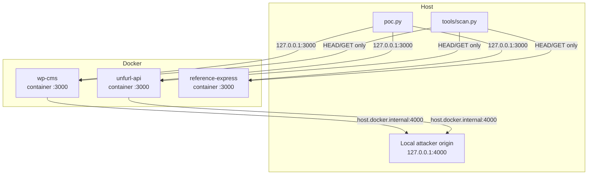
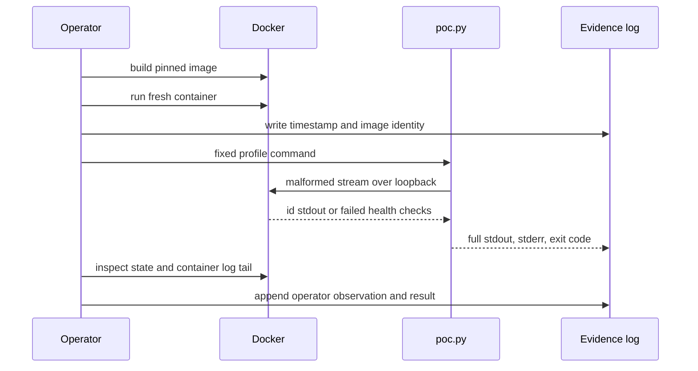

# Architecture

Node2Shell Lab is a set of three deliberately vulnerable applications, one
reproducer, and an evidence pipeline. Every component is local. Nothing in the
repository is intended for a public network.

## Components

| Component | Role | Runtime |
| --- | --- | --- |
| `labs/wp-cms` | WordPress-style CMS with a JSON media sink and an import sink | Node.js v24.22.0, Express 5.3.0 |
| `labs/unfurl-api` | Link unfurler that consumes an upstream body | Node.js v24.22.0, undici 8.12.3 |
| `labs/reference-express` | Minimal fixture for the exact-binary RCE profile | Node.js v24.22.0, Express 5.3.0 |
| `poc.py` | Loopback reproducer with fixed payloads and proof checks | Python 3.11+, standard library |
| `profiles.json` | Exact image, binary, package, probe, and evidence metadata | JSON |
| `tools/scan.py` | Passive three-asset triage | Python 3.11+, standard library |

## Network layout



Only one lab uses host port `3000` at a time in the RCE workflow. The passive
scan Compose file maps the three labs to `19200`, `19201`, and `19202` so they
can run together.

## Inbound path

The CMS and reference labs use Express with a route-scoped parser:

```text
request
  -> Node.js HTTP server
  -> Express router
  -> express.json()            (default limit, default options)
  -> Brotli request inflation
  -> JSON parse
  -> route handler
```

No logging, authentication, or body middleware runs before the parser on the
media or upload route. That order is part of the tested profile. Adding a
global parser or changing the default options changes the profile.

## Outbound path

The unfurl API and the CMS import route accept a URL, fetch it, and read the
entire response:

```text
POST /api/unfurl or /wp-json/node2shell/v1/import
  -> JSON request body
  -> URL validation against a loopback allowlist
  -> fetch() or undici
  -> encoded response inflation
  -> arrayBuffer() / body consumption
```

The local attacker origin is a Python socket listener on `127.0.0.1:4000`. A
Docker Desktop container reaches it as `host.docker.internal`. On a Linux
Docker Engine that does not provide that name, start the container with
`--add-host host.docker.internal:host-gateway`.

## Process model

Each image has a small supervisor at `/usr/local/bin/node2shell-supervise`.

- `N2S_SUPERVISE=0` (default) uses `exec node /app/server.js`. A decoder crash
  stops the service, which is required for the DoS check.
- `N2S_SUPERVISE=1` loops: run Node, wait for the crash, log the restart, sleep
  one second, run again. The one-second gap makes the down window observable
  and gives each RCE attempt a fresh address-space layout.

The RCE profile also sets `UV_THREADPOOL_SIZE=1`. The accepted request socket
must be file descriptor 19 for the exact chain in `profiles.json`.

## Trust boundaries

1. **Host to container.** Only the declared loopback port is published.
2. **Container to host.** The outbound fetch is restricted to
   `127.0.0.1`, `localhost`, and `host.docker.internal`.
3. **PoC to target.** `poc.py` accepts only fixed loopback hosts and the
   profile's port. It accepts no command, URL, or path from the caller.
4. **Proof to claim.** A PASS is decided from the declared interface only:
   fresh `id` output or four failed health checks. Operator observations are
   appended to the log but do not change the PoC result.

## Evidence flow



The evidence logs are immutable inputs to `docs/evidence/MATRIX.md`. The
checksums in `docs/evidence/SHA256SUMS` cover every text log.

## Non-goals

- A production exploit framework.
- A scanner that proves exploitability.
- A universal RCE claim across Node.js versions.
- A substitute for the vendor patch.
